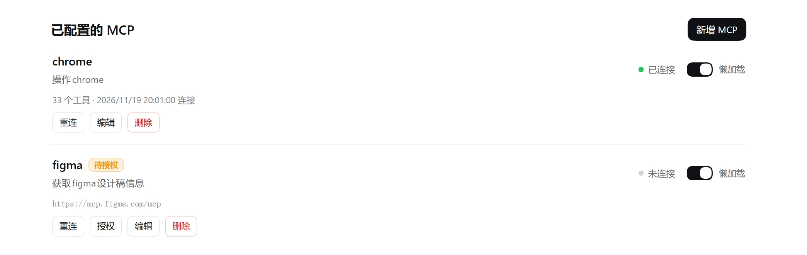

# MCP 增强

DSH 插件 `dsh-plugin-better-mcp`：用一个面板管理 MCP 服务器，让模型按需加载工具。

- **可视化管理**：在面板里新增、编辑、删除服务器，随时查看连接状态。
- **一键鉴权**：需要登录的服务器在操作行下方显示「点击鉴权」与完整地址，点击后由 DSH 打开鉴权页。
- **按需加载**：服务器的工具默认收起，模型需要时自己打开，节省上下文。

